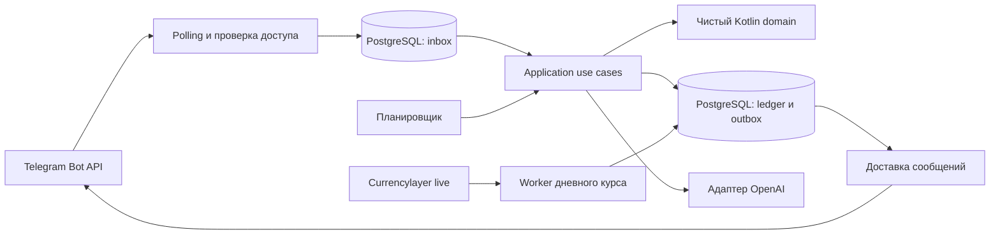

# Архитектура, технологии и code style

Это общий источник инженерных решений для всех трёх ролей. Ролевые SKILL.md перечислены в [AGENTS.md](AGENTS.md). Ниже описана **целевая** архитектура; реализованное состояние перечислено в [CONTEXT.md](CONTEXT.md), порядок внедрения — в [PLANS.md](PLANS.md).

## 1. Рекомендуемый стек

| Область | Решение | Причина / граница |
| --- | --- | --- |
| Язык и сборка | Kotlin, Gradle Kotlin DSL, Gradle Wrapper | Сохранить текущий проект; не менять версии попутно с функциональностью |
| Runtime | Java 17 на первом этапе | Уже закреплена toolchain; смена JDK — отдельное проверяемое решение |
| Приложение | Spring Boot 4.1.1, один JVM-процесс | Patch-обновление с 4.1.0 проверено в T01; новые обновления выполнять отдельно от функциональных изменений |
| Хранение | PostgreSQL 17, Spring JDBC / `JdbcClient`, HikariCP | Явный SQL упрощает агрегаты расходов и контроль транзакций; JPA в исходной архитектуре не нужен |
| Схема | Flyway SQL-миграции | Одинаковая схема локально, в тестах и на хостинге |
| Telegram | Официальный Bot API через Spring `RestClient` | Небольшой типизированный адаптер для нужных методов, без зависимости от совместимости стороннего starter |
| Получение сообщений | Long polling, один активный poller | Личный бот работает без публичного webhook и домена |
| OpenAI | Responses API, официальный `com.openai:openai-java`, Structured Outputs | Отдельный адаптер для распознавания и пояснений, без внедрения SDK в домен |
| Расписание | Spring Scheduling + задания и доставка в PostgreSQL | Переживает рестарт; отдельный брокер сообщений не нужен |
| Валидация и JSON | Bean Validation на границах, Jackson из совместимого Boot-набора | Проверять совместимость модулей и SDK, особенно Jackson 2 / 3; не переопределять BOM вслепую |
| Тесты | JUnit Jupiter, `kotlin-test` / AssertJ, MockK при необходимости | Версии платформы JUnit согласовывать с BOM Spring Boot |
| Интеграционные тесты | Testcontainers PostgreSQL + WireMock | Настоящие миграции и SQL; внешние API заменяются локальным HTTP-сервером |
| Качество | ktlint 1.8.0, Detekt 2.0.0-alpha.3, JaCoCo 0.8.15 | Подключены в T01; метрики покрытия помогают найти пробелы, но не заменяют проверки денежных сценариев |
| Эксплуатация | Docker, Docker Compose для локальной БД, Actuator, Micrometer, SLF4J | Healthcheck, видимость задержек и ошибок; отдельный стек мониторинга пока не требуется |
| CI | GitHub Actions при размещении репозитория в GitHub | Проверки на PR, сборка образа после успешных проверок |

Факты о совместимости сверены 2026-09-06: [Spring Boot system requirements](https://docs.spring.io/spring-boot/system-requirements.html), [Spring JdbcClient](https://docs.spring.io/spring-framework/reference/data-access/jdbc/core.html#jdbc-JdbcClient), [поддержка PostgreSQL](https://www.postgresql.org/support/versioning/), [Testcontainers PostgreSQL](https://java.testcontainers.org/modules/databases/postgres/). Точные версии новых зависимостей закрепить после проверки сборки; не использовать динамические `+`, snapshot или контейнерный `latest`.

В T07 закреплены официальный Java SDK `4.61.0`, Responses API и предварительный точный snapshot
`gpt-4o-mini-2024-07-18` с поддержкой Structured Outputs. `OPENAI_MODEL` задаётся конфигурацией, но не
должен быть плавающим alias. Окончательный выбор выполняется по зафиксированному русскоязычному корпусу,
качеству, задержке и usage; до явно выбранного живого прогона статус модели предварительный. Более дорогую
модель добавлять только при измеримой пользе. Источники: [OpenAI SDKs](https://developers.openai.com/api/docs/libraries), [Structured Outputs](https://developers.openai.com/api/docs/guides/structured-outputs).

Spring AI можно рассмотреть позднее при появлении нескольких AI-провайдеров. Для текущих двух сценариев дополнительная абстракция не требуется. Redis, Kafka, Kubernetes, vector database и отдельные микросервисы не входят в базовый стек.

## 2. Хостинг

**Рекомендация для первого размещения — Railway: постоянно работающий контейнер приложения и отдельный PostgreSQL-сервис с постоянным томом.** Платформа поддерживает развёртывание Spring Boot и Dockerfile; это сокращает подготовку окружения. Перед запуском проверить доступность региона, оплаты, резервных копий и ограничения выбранного тарифа. Источник: [Railway Spring Boot](https://docs.railway.com/guides/spring-boot).

Для T11 выбран GitHub-connected Railway service без public domain и app-volume: один экземпляр long-polling
приложения в том же регионе, что private PostgreSQL. Railway Serverless выключен, readiness включает DB,
deployment overlap равен нулю, а draining превышает Spring/Telegram shutdown timeout. Railway service settings
задаются в dashboard: прежний `railway.json` deprecated для новых services. Источники:
[GitHub autodeploy](https://docs.railway.com/deployments/github-autodeploys),
[healthchecks](https://docs.railway.com/deployments/healthchecks),
[Config as Code deprecation](https://docs.railway.com/config-as-code).

| Вариант | Когда выбирать | Что учесть |
| --- | --- | --- |
| Railway | Нужен быстрый старт с небольшой эксплуатационной нагрузкой | Обеспечить работу без засыпания, один активный poller, постоянный том БД, backup и лимит расходов |
| Небольшой Linux VPS + Docker Compose | Нужен контроль окружения и подходит самостоятельное администрирование | Обновления ОС, firewall, мониторинг, off-host backup и восстановление выполняет владелец |
| Render с постоянно работающим платным сервисом | Подходит управляемая альтернатива | Убедиться, что выбранный тип сервиса непрерывно выполняет фоновые задачи |

Бесплатный Render web service засыпает после 15 минут без входящего трафика; исходящий Telegram polling не обеспечивает входящий запрос. Поэтому такой режим не подходит для обязательной утренней отправки по расписанию. Источник: [ограничения Render Free](https://render.com/docs/free).

Конкретная стоимость пока не утверждена. Смета включает приложение 24/7, БД и диск, резервные копии, трафик и OpenAI. Начальный ориентир для проверки ресурсами: приложению 512–1024 MiB RAM с запасом вне heap; реальную конфигурацию выбрать по измерениям JVM и стоимости. Это оценка проекта, а не гарантия провайдера. Развёртывание и подключение платных услуг выполняются отдельной задачей T11.

## 3. Архитектура приложения

Один Gradle-модуль и один deployable Spring Boot app, организованный по функциональности. У каждого сложного модуля есть `domain`, `application` и `infrastructure`; не создавать пустые пакеты заранее.

```text
com.firkatdavletov.financeconsultante
├── FinanceConsultanteApplication.kt
├── access/         # приглашения, роли и жизненный цикл членства в семейном бюджете
├── ledger/         # операции, категории, исправления, учётный баланс
├── budget/         # период, свободные средства, дневной лимит
├── recurring/      # правила платежей и конкретные обязательства по датам
├── analytics/      # агрегаты, сравнение, прогноз
├── exchange/       # Currencylayer, персистентные дневные задания и retry
├── goals/          # цели, фактические allocations и будущие планы взносов
├── advice/         # сценарий покупки и пояснения по вычисленным данным
├── telegram/       # polling, команды, callback, представление ответов
├── ai/             # адаптер OpenAI и версии prompt/schema
├── notifications/  # расписание, очередь исходящих сообщений, доставка
└── shared/         # только общие Money, Clock/config и технические типы
```



`domain` не зависит от Spring, SQL, Telegram или OpenAI. `application` координирует сценарий и объявляет порты хранения/внешних сервисов; реализации портов находятся в `infrastructure`. Spring-транзакции допустимы в application-сервисах. Межмодульное обращение идёт через application API; общий `shared` не превращать в хранилище всей бизнес-логики. Сложные аналитические запросы разрешено выполнять через отдельный read-port с SQL-проекциями.

Telegram handler преобразует update в команду и представляет результат. Все проверки денег и доступа действуют и при вызове use case без Telegram. DTO транспорта, доменные модели и persistence-записи разделять по реальной границе; не добавлять промежуточные DTO без преобразования смысла.

## 4. Данные и инварианты

Предлагаемые сущности; миграции вводить вместе с задачей, которая их использует:

| Сущность | Ключевые данные и правила |
| --- | --- |
| `Household` | Основная валюта KZT, timezone Asia/Almaty, время отчёта 08:00, неотрицательный денежный резерв KZT; один общий счёт |
| `Member` | Положительный `telegramUserId: Long`, `householdId`, OWNER/MEMBER, `joinedAt`/`revokedAt`, настройка отчётов; один OWNER на household и не более одного активного household на Telegram ID |
| `FamilyInvitation` | Приглашённый Telegram ID, пригласивший OWNER, PENDING/ACCEPTED/REVOKED, идемпотентный источник; одно активное приглашение на Telegram ID |
| `Account` | Один сводный счёт, начальный остаток и момент начала учёта; остаток не является доходом |
| `Category` / `CategoryRule` | Стабильный ID, название, тип операции, пользовательские правила; использованные категории архивируются |
| `LedgerEntry` | UUID, household/account, тип, положительная исходная сумма KZT/RUB, оценка в KZT, курс, категория, короткое нормализованное описание, `occurredAt`, `createdAt`/`modifiedAt`, статус POSTED/VOIDED, версия, источник и ссылка возврата |
| `DailyExchangeRate` | Один снимок на местную дату: KZT за 1 RUB, код источника, время котировки и получения; повторная фиксация не перезаписывает курс |
| `ExchangeRateJob` | Одна персистентная задача на дату, срок 07:00 Asia/Almaty, статус/попытки, следующий retry и lease; включает выходные и переживает рестарт |
| `EntryRevision` | Снимки создания, исправлений, возвратов и отмен с причиной, автором и источником мутации |
| `TransactionDraft` | Неоднозначная или AI-распознанная запись, короткое нормализованное описание, автор, состояние и версия для callback; не влияет на баланс |
| `RecurringRule` / `Occurrence` | Периодичность, сумма, срок конкретного платежа, оставшаяся неоплаченная часть и связь с фактической записью |
| `RecurringExpenseCandidate` / `Evidence` | Версионное предложение недельного/месячного правила, PENDING/ACCEPTED/REJECTED, fingerprint и ссылки на подтверждающие ledger-записи; само не является обязательством |
| `ExpectedIncome` | Ожидаемые сумма и дата для прогноза; не доход в ledger до фактического поступления |
| `SavingsGoal` / `Allocation` | Сумма, срок, приоритет и фактически выделенная часть имеющихся KZT; allocation имеет источник идемпотентности и аудит reserve/release/spend |
| `GoalContributionPlan` | Будущий план взноса в KZT; до фактического reserve не входит в B или G и может быть отменён без проводки |
| `TelegramInbox` / `PollingState` | Уникальный `(botId, updateId)`, точный `memberId` на момент приёма, минимально необходимый payload, статус, попытки, срок lease и сохранённый offset |
| `TelegramDialog` | Сохранённый шаг настройки владельца и черновик остатка/даты/времени/резерва; отмена очищает черновик, завершение атомарно создаёт бюджет |
| `NotificationJob` / `OutboxMessage` | Получатель и точный `memberId`, тип, период, срок, готовый текст, статус, попытки и `telegramMessageId` после успешной доставки |

В таблицах финансовых данных хранить `household_id`; составные FK проверяют принадлежность счёта, категории и автора тому же бюджету и соответствие типа категории направлению. Денежные поля — `BigDecimal` и домен PostgreSQL `money_amount` поверх `NUMERIC` с `scale <= 2` и диапазоном ±99 999 999 999 999 999,99. Это диапазон `NUMERIC(19,2)`, но без неявного округления: PostgreSQL округляет значение к объявленному scale до проверки `CHECK`, поэтому тип `NUMERIC(19,2)` сам по себе не отклоняет ввод `1.001`. Источник: [PostgreSQL numeric](https://www.postgresql.org/docs/17/datatype-numeric.html). Диапазон и scale также проверяются до записи в Kotlin. Сумма операции строго положительна; направление задаётся типом INCOME / EXPENSE / EXPENSE_REFUND. Возврат расхода увеличивает остаток и уменьшает чистые расходы категории, отдельно виден в отчёте и не становится зарплатой. Для возврата по возможности сохраняется ссылка на исходный расход (T06).

Поддерживаются ровно KZT и RUB; основная валюта сводного счёта — KZT. Начальный остаток вводится в KZT. Курс — положительное decimal-значение KZT за 1 RUB, до 8 знаков после запятой, не больше 99 999 999 999,99999999. Для RUB Kotlin умножает исходную сумму на снимок курса местной даты операции и один раз округляет оценку до сотых KZT через `HALF_UP`. Исходная сумма не округляется. Схема проверяет совпадение оценки с произведением и связывает дату/значение курса составным FK с `daily_exchange_rate`. Без курса этой даты операция не записывается; не подставлять 1 или незаметно использовать произвольный старый курс. Нулевой результат конвертации отклоняется. Поздний ввод требует исторического курса; новый дневной курс не меняет существующие проводки. T02 предоставляет хранение/фиксацию и конвертацию, T02A — загрузчик и ежедневное выполнение, в том числе для выходных.

Источник T02A — Currencylayer [`/live`](https://currencylayer.com/documentation). Endpoint возвращает котировки с базой USD, поэтому курс вычисляется детерминированно как `USDKZT / USDRUB` с scale 8 и `HALF_UP`; источник сохраняется как `CURRENCYLAYER_LIVE_USD_CROSS`. Вместе со снимком хранятся `quoted_at` из UTC timestamp провайдера и локальное `fetched_at`. Устаревший, будущий, нулевой, неполный или ошибочный ответ не создаёт курс. Поскольку выбран live, восстановление пропущенного дня и явный запрос прошлой даты фиксируют первый успешно полученный live-снимок с честными timestamps, а не выдают его за историческую котировку этой даты. Это правило одинаково для рабочих и выходных дней.

В T02 timezone бюджета зафиксирован как Asia/Almaty по подтверждённой настройке владельца; `occurred_on` в БД вычисляется в этой зоне. Изменение зоны потребует отдельной миграции правила валютной даты, а не только смены строки настройки. `report_time` хранится с точностью до минуты, по умолчанию 08:00. Ежедневная отправка появится в T09; наличие настройки и таблицы курса не означает работающего расписания.

Все варианты `700`, `700.0`, `700,00`, `15 000` нормализуются парсером к одной денежной модели. Ввод с лишними дробными знаками отклоняется с пояснением; не округлять введённую пользователем сумму молча. `0`, отрицательная сумма без отдельного понятного сценария, неизвестная валюта, переполнение и неясные сокращения требуют исправления/уточнения. `BigDecimal` создаётся из строки, сравнение после нормализации scale либо через `compareTo`.

Учётный баланс = начальный остаток + POSTED-доходы − POSTED-расходы + POSTED-возвраты в пределах времени учёта. Начальный остаток фиксирует состояние перед первой учитываемой операцией; операция до этой границы требует отдельного решения, чтобы не задвоить историю. Отрицательный баланс допустим, но явно отображается. Подтверждение черновика, изменение ledger, запись аудита и соответствующая запись outbox выполняются атомарно. Исправления используют optimistic locking; отмена повторного callback не меняет деньги второй раз.

Будущий доход не увеличивает текущий остаток. Предстоящий платёж не списывает деньги до фактической операции. Перекладывание в накопления внутри сводного счёта только резервирует часть средств, не создаёт доход или расход. Реальные переводы между отдельными счетами требуют отдельной модели за пределами MVP.

В T08 плановые суммы обязательств и ожидаемых доходов хранятся в базовой валюте KZT: неизвестный будущий
курс RUB не подменяется произвольной оценкой. `RecurringRule` задаёт MONTHLY с числом 1–31 либо WEEKLY с
ISO-днём недели 1–7. Дни 29–31 переносятся на последний день короткого месяца. Конкретный `Occurrence`
уникален по `(rule_id, due_on)`; повторная генерация безопасна, а обновление суммы меняет только будущие
неоплаченные occurrences. Деактивация отменяет будущие обязательства, не удаляя просроченную и оплаченную
историю.

Фактическая оплата обязательства — POSTED `EXPENSE` с отдельной связью в
`recurring_occurrence_payment`; частичные оплаты разрешены, а оставшаяся часть равна
`max(0, planned_amount - сумма POSTED-связей)`. Версия occurrence и уникальность ledger-связи не допускают
повторную оплату тем же подтверждением. Ожидаемый доход аналогично не является проводкой. Явное получение
создаёт `INCOME`, а сопоставление может связать уже записанный KZT-доход той же категории. Наличие хотя бы
одной POSTED-связи исключает ожидание из прогноза целиком, в том числе при фактической сумме выше плановой;
VOIDED-связь не считается исполнением.

В T12 цель хранит target, deadline, priority, текущий `allocated_amount` и версию. `G` — сумма только этих
фактических allocations; будущие `GoalContributionPlan` и полная стоимость целей в G не входят. Reserve и
release являются внутренним распределением имеющегося B, не создают ledger-entry и не меняют аналитику.
Перед reserve счёт и household блокируются, затем проверяется `B − R − E − G`; та же блокировка сериализует
параллельные allocations разных целей. Каждая мутация имеет уникальный source key, а изменение G увеличивает
`settings_version`, чтобы дневной снимок пересчитался.

Расход из цели создаёт обычный KZT `EXPENSE` и связанную allocation-запись `SPENT` в одной транзакции. B и G
уменьшаются на одну сумму, поэтому F не вычитается повторно. Схема проверяет принадлежность household,
положительные суммы, `allocated_amount <= target_amount`, KZT и обязательную связь SPENT с EXPENSE.

Моменты хранятся как `Instant` / PostgreSQL `timestamptz`; финансовые timestamps допускают точность до микросекунд, чтобы округление БД не переносило операцию на следующую валютную дату. Локальные даты и границы периодов вычисляются в `ZoneId` бюджета. Для отчётов использовать интервалы `[startInclusive, endExclusive)`. Неделя — понедельник–воскресенье, месячный отчёт — завершённый календарный месяц. Время приходит через внедрённый `Clock`, а не системные вызовы внутри расчёта.

## 5. Разбор сообщения и надёжность записи

1. Принять только поддерживаемый update, проверить числовой Telegram user ID, личный чат и принадлежность бюджету. Сначала команды (`/start`, `/balance`, `/report`), затем сообщения о деньгах. Не путать вопрос о покупке с фактом расхода.
2. Сохранить разрешённый update в inbox и offset в одной короткой DB-транзакции. Только после commit разрешено вызвать `getUpdates` с увеличенным offset. В пакете нельзя перескочить через update, который не сохранён или не обработан как окончательно игнорируемый.
3. Worker обрабатывает сохранённые сообщения в порядке поступления для конкретного чата. Статусы RECEIVED → PROCESSING → PROCESSED / NEEDS_INPUT, либо RETRY / FAILED. Lease даёт восстановить незавершённую работу после рестарта. Игнорируемые события также не должны блокировать polling навсегда.
4. Локальный parser извлекает сумму/дату/тип; словарь и подтверждённые правила определяют категорию. Явно однозначные примеры из CONTEXT записываются сразу.
5. Для непонятного текста при включённом AI вызвать порт классификации вне DB-транзакции. Проверить результат; в MVP показать владельцу черновик перед проводкой. При недоступном AI предложить явный формат или выбор категории. Несколько операций в сообщении в MVP требуют раздельного ввода.
6. Use case проверяет все поля и повторную обработку. В одной транзакции фиксирует результат, состояние inbox/draft, ledger/audit и outbox. На уровне БД уникален источник записи — исходный inbox/draft; финальный callback не становится новым финансовым источником.
7. Worker доставки отправляет готовый ответ из outbox после commit. Кнопки «Исправить» и «Отменить» привязаны к объекту и версии; сервер заново проверяет автора и права. Изменённый в Telegram текст (`edited_message`) в MVP не меняет ledger автоматически; бот направляет к явному исправлению записи.

В T03 реализован `telegram/` с чистым `SetupConversation`, application-портами и JDBC/RestClient-адаптерами. `TELEGRAM_OWNER_ID` проверяется до сохранения текста, повторно перед настройкой и доставкой. Начальная настройка создаёт бюджет только после всех ответов; начальный остаток/дата защищены от изменения после проводок также триггером PostgreSQL. Базовая валюта и timezone остаются фиксированными.

В T04 реализован чистый `ledger/domain/TransactionMessageParser`: полное совпадение со строгой грамматикой одной операции, без извлечения подходящего фрагмента из произвольной фразы. Публичный результат — `MessageParseResult` с вариантами `RecordTransaction`, `PurchaseQuestion`, `Command`, `NeedsClarification`. `TransactionCategory` задаёт стабильный ключ начального словаря и направление, не подменяя UUID категории конкретного бюджета. `RecordTransaction` содержит исходный `Money` и `LocalDate`, не оценивает RUB в KZT и не пишет ledger. Неизвестные категории, несовместимое направление, неподдерживаемая валюта, неточная сумма и будущая дата требуют уточнения. Время передаётся через параметр `today` в зоне бюджета; синтаксис и ограничения описаны в README и `/help`. В T05 parser подключён к inbox, а `LedgerOperations` разрешает ключ словаря в категорию конкретного бюджета. Категория создаётся при первом использовании; существующая одноимённая категория сохраняет UUID и статус архивации.

Локальный обработчик удерживает блокировку строки polling-state, выбирает первый доступный inbox и выполняет
настройку либо draft/ledger/audit, outbox и PROCESSED в одной короткой транзакции. Для OpenAI первая транзакция
создаёт `openai_recognition_job` и переводит сообщение в `OPENAI_PENDING`; следующий inbox этого бота ждёт,
сохраняя порядок чата. Worker коротко захватывает job с lease и резервирует дневные request units, выполняет
HTTP без DB-транзакции, затем атомарно сохраняет usage/статус, draft/fallback, outbox и завершение inbox.
Просроченный `PROCESSING` lease позволяет продолжить job после crash. Текст обработанного/окончательно
отклонённого inbox удаляется сразу.

В T05/T05-UX1 `TransactionDraft` хранит структурированное предложение, исходный inbox, бюджет/автора,
состояние `NEEDS_INPUT` / `READY` / `WAITING_RATE` / `CONFIRMED` / `CANCELLED` и версию. Частичный unique
допускает один `NEEDS_INPUT` на бота и владельца; готовые `READY`/`WAITING_RATE`-предложения независимы и
привязаны к собственным исходным inbox. Следующее полное сообщение уточняет только `NEEDS_INPUT`, увеличивая
его версию, и не заменяет уже готовый черновик. `/draft` показывает активные черновики постранично; callback
и fallback-команды `/confirm <id> <версия>` / `/cancel <id> <версия>` проверяют область доступа и версию.
Источник `telegram:<botId>:inbox:<sourceInboxId>` остаётся исходным inbox независимо от числа уточнений.
Подтверждение, ledger/audit и outbox фиксируются одной транзакцией; конечное состояние повторно не открывается.

В T06 `EntryCorrections` сериализует финансовые изменения блокировкой сводного счёта и выполняет
compare-and-set по версии записи. Исправление сохраняет UUID и исходный финансовый источник, пересчитывает
оценку RUB по неизменяемому снимку новой даты и в той же транзакции добавляет `entry_revision`. Каждая мутация
имеет уникальный источник inbox. Отмена меняет статус на `VOIDED`; повторный или устаревший callback не может
затронуть новую версию либо другую запись.

Возврат хранится отдельной `EXPENSE_REFUND`-проводкой с `refund_of` на `EXPENSE` того же household.
Лимит возврата проверяется в исходной валюте, поэтому разные дневные курсы RUB не искажают доступную сумму.
Связанный возврат увеличивает версию расхода, чтобы старые кнопки не могли параллельно изменить основание.
Исправление расхода запрещено, пока у него есть проведённые возвраты; их можно явно отменить.

`CategoryRule` связывает нормализованное точное слово с категорией и ревизией, где владелец явно исправил
категорию. Архивирование сохраняет категорию и историю, но блокирует новые записи и применение правила.
Telegram callback и `edited_message` проходят ту же проверку активного членства до сохранения; обработанный
`edited_message` не хранит исправленный финансовый текст. Inline-клавиатура сохраняется в outbox вместе
с готовым ответом, а доставка подтверждает callback через `answerCallbackQuery`.

Относительная дата parser привязана к исходному Telegram `message.date`, сохранённому как `message_sent_at`; смысл поля проверен по документации [Telegram Message](https://core.telegram.org/bots/api#message). Проводка T05 получает начало выбранной местной даты; момент отправки остаётся в inbox до его обработки. Для строк до V4 дата неизвестна (`NULL`), поэтому денежный ввод требует повторения. Граница начала учёта не сдвигается автоматически. `/balance` включает текущую микросекунду; API периодов сохраняет интервалы `[start, end)`. `/history` читает максимум 11 строк, показывает 10 и курсор `history_sequence` следующей страницы в порядке добавления, устойчивый к новым и задним числом введённым операциям.

При отсутствии курса RUB черновик получает `WAITING_RATE`, а дата ставится в существующую персистентную очередь без HTTP внутри транзакции inbox. После загрузки владелец повторяет подтверждение; автоматическое проведение и отдельное уведомление не входят в T05. Недопустимая оценка RUB в KZT требует уточнения. Черновики не участвуют в балансе и не хранят полный исходный текст.

Polling и доставка имеют персистентные lease по времени БД и UUID-token для защиты от устаревшего worker; HTTP выполняется вне транзакций. По умолчанию poll timeout 25 секунд, HTTP timeout 35 секунд, lease 90 секунд. Все экземпляры одного бота используют одну БД. Очередь ответов хранит готовый plain-text текст, имеет уникальный inbox business key, сохраняет `telegram_message_id`, соблюдает `retry_after` и прекращает доставку после пяти попыток, включая повторные аварии с истёкшим lease. Три ограниченных потока позволяют polling, обработке и доставке работать независимо. T03 не включает scheduler финансовых отчётов.

Long polling и webhook не включаются одновременно. Offset подтверждает ранее полученные updates на стороне Telegram, поэтому его нельзя продвигать до сохранения. Telegram хранит недоставленные updates ограниченное время (до 24 часов): длительный простой нельзя обещать восстановить полностью. Источник: [Telegram, getting updates](https://core.telegram.org/bots/api#getting-updates).

Сбой между отправкой `sendMessage` и фиксацией SENT в БД может привести к повторному сообщению: Telegram не предоставляет здесь клиентскую гарантию exactly-once. Использовать уникальный business key для outbox и ограниченные повторы; возможный дубль ответа не должен создавать дубль финансовой операции. Не обещать абсолютно однократную сетевую доставку.

### Семейный доступ T16

`TELEGRAM_OWNER_ID` остаётся bootstrap-идентификатором единственного OWNER. Он приглашает положительный
числовой Telegram ID; приглашённый сам принимает доступ в private chat. OWNER управляет настройками,
участниками, категориями, recurring/expected, общими целями и всеми ledger-записями. MEMBER читает общие
агрегаты и планы, создаёт проводки и меняет только записи/черновики, где `actor_id`/`member_id` совпадает с
его текущим членством. Application-сервисы проверяют роль независимо от Telegram handler.

Inbox и outbox фиксируют UUID членства, а не только Telegram ID. Активность этой точной версии членства
проверяется перед обработкой, вызовом OpenAI и доставкой. Revoke помечает членство завершённым, выключает
report recipient и завершает ожидающие report jobs/outbox; ledger, revisions и авторство не удаляются.
Повторное приглашение создаёт новый UUID, поэтому update или callback прежнего членства не оживает. История
общая и показывает числового автора. Групповые чаты остаются запрещёнными.

Фактические ledger-записи сериализуются блокировкой общего account, но отрицательный баланс разрешён:
конкурентные траты обоих участников сохраняются. Резервирование целей сохраняет прежнюю блокировку account и
household, поэтому одни свободные деньги нельзя выделить дважды. Все финансовые таблицы и lookup ограничены
`household_id`; подстановка UUID из другого household не даёт чтение или мутацию.

## 6. Дневной лимит, прогноз и рекомендации

Базовый алгоритм — проектное правило планирования доступных денег, а не оценка банковского баланса. Расчёт выполняется на согласованном снимке данных:

```text
B = текущий учётный баланс
R = оставшиеся обязательные платежи до конца месяца + просроченные неоплаченные
E = защищённый денежный резерв из уже имеющегося B
G = средства, уже фактически выделенные на цели из B
F = B - R - E - G
D = число местных календарных дней от сегодня до конца месяца включительно
дневной лимит = floor(max(0, F) / D) до целой единицы базовой валюты
```

Резервы `E` и `G` не пересекаются. `G` — не полная стоимость цели и не будущие ежемесячные взносы. При оплате обязательства уменьшается B и одновременно погашается соответствующая часть R; один платёж не резервируется повторно. Если денег не хватает на R/E/G, показывать дефицит `max(0, -F)` и нулевой лимит. При отсутствии начального остатка или списка обязательств отмечать неполные данные, а не утверждать, что тратить безопасно.

Контрольный пример: B = 300 000, R = 100 000, E = 50 000, G = 30 000, D = 10 → F = 120 000, лимит = 12 000. После оплаты включённого в R платежа 20 000: B = 280 000, R = 80 000, F остаётся 120 000. После обычного расхода 10 000 F становится 110 000.

Утренний отчёт показывает лимит на оставшуюся часть дня. Хранить время среза `asOf`, учтённые версии операций и исходный лимит. При повторном запросе остаток лимита = `max(0, исходный лимит − новые учитываемые повседневные расходы + их возвраты)`: вычитать только операции после среза, ещё не включённые в B снимка. Например, трата в 07:00 уже уменьшила B отчёта в 08:00 и не вычитается повторно; новая трата в 09:00 уменьшает оставшийся лимит. Оплата обязательства, уже вычтенного в R, также не вычитается из лимита повторно. Возврат расхода, вошедшего в B до снимка, новый доход, изменение резервов, поздний ввод или исправление истории требуют перерасчёта снимка. Бот помечает перерасчёт; уже включённые в новый B расходы повторно не вычитает. Остаток лимита не должен превышать текущие свободные средства.

Оценка бюджета в MVP: «данных недостаточно» при незавершённой настройке; «дефицит» при F < 0; «свободных средств нет» при F = 0; «есть доступные средства» при F > 0 с указанием суммы и лимита. Это оценка по введённым данным; отсутствие дефицита сейчас не обещает отсутствие кассового разрыва в будущем.

Прогноз отдельно строит движение денег по датам из текущего остатка, ожидаемых доходов, обязательств и оценки обычных трат. Сверять план с уже исполненными операциями, чтобы не включать их дважды. Для среднего расхода учитывать и дни без трат, исключать регулярные платежи, уже заложенные в R. При недостатке истории показывать предварительность оценки и допущения. Базовый и осторожный сценарии отличаются явно заданными параметрами, например задержкой ожидаемого дохода, а не случайным числом от LLM.

В T13 горизонт `/forecast` зафиксирован как 30 местных календарных дат, включая сегодня. Средняя обычная
трата равна чистым несвязанным расходам за доступную часть последних 30 завершённых дней, делённым на число
этих дней; нулевые дни входят в знаменатель. Связанный с `Occurrence` расход и возврат такого расхода не
входят в среднее, потому что неоплаченный остаток occurrence уже является отдельным cash-flow. Если доступно
меньше 14 завершённых дней, переменная трата не считается надёжной: фиксированные движения показываются с
оговоркой, а пользователь может явно передать `/forecast <лимит KZT в день>`.

Базовый сценарий применяет среднюю или ручную дневную сумму. Осторожный сценарий детерминированно повышает
её на 20% с округлением вверх до тиына и переносит каждый ожидаемый доход на 3 дня; сдвинутый за пределы
горизонта доход не попадает в итог. Ожидаемый доход появляется в базовом календаре только в `due_on` и
исключается целиком после любой POSTED-связи. Обязательство содержит только `max(0, planned - POSTED payments)`;
просроченный остаток относится к первому дню горизонта. Расчёт выполняется в `REPEATABLE_READ` после проверки
OWNER и может идемпотентно материализовать occurrences активных правил, но не создаёт и не изменяет ledger.

Фактические allocations целей и E остаются внутри B и не становятся повторными денежными оттоками. План
взноса используется только для оценки достижимости: в дату плана сумма может увеличить прогнозную allocation
не больше остатка цели и доступного `balance − E − projected G`. Само резервирование не меняет дневной cash
balance и не создаёт финансовую проводку. Для каждой цели показывается базовая и осторожная оценка внутри
30-дневного горизонта; более дальний срок явно отмечается как находящийся за горизонтом.

Анализ покупки получает сумму/дату, показывает остаток и дневной лимит после покупки, влияние на резервы/цели и минимальный остаток в прогнозе. Запрос анализа сам не создаёт расход. Недостающие параметры уточняются. Текстовые рекомендации объясняют готовые показатели и действия; LLM не придумывает суммы, факты расходов, проценты экономии или гарантии результата.

В T14 этот сценарий реализован в `advice` как чистая симуляция поверх одного согласованного набора входов
прогноза T13. Покупка допускается в ближайшие 30 местных дней, а проекция продолжается до конца месяца
последней допустимой даты, чтобы дневной лимит не терял более поздние обязательства. Посильность оценивается
по осторожному сценарию: `F` после покупки неотрицателен, cash balance не уходит в минус и ни в один день
не затрагиваются `E` и прогнозный `G`. Поиск даты отсрочки не скрывает дефицит, возникший до будущего дохода.

Для связанной цели purchase-event одновременно уменьшает прогнозные `B` и allocation этой цели на доступную
сумму; последующие планы взносов пересчитываются с новым остатком. Так моделируется инвариант фактического
`/goals spend` без двойного вычета. Симуляция не сохраняется, не изменяет ledger или allocations и не является
подтверждением фактической покупки; запись выполняется только отдельной явной командой.

В T15 `RecurringExpenseDetector` остаётся чистым Kotlin-domain и получает зафиксированную
`RecurrenceDetectionPolicy`. Кандидаты группируются по `(categoryId, normalizedDescription)` и требуют не
менее трёх близких сумм с недельными или месячными интервалами. Конфигурация по умолчанию: lookback 400 дней,
неделя `7 ± 1`, месяц `30 ± 4`, один пропущенный период, допуск суммы 20% и порог роста 5%. Значение 31
означает последний день месяца. В доказательства сохраняются максимум шесть последних подходящих операций;
владелец видит их даты, суммы и UUID вместе с фактическими интервалами.

Read-port рассматривает только POSTED `EXPENSE` с непустым нормализованным описанием и исключает возвраты,
VOIDED-записи, уже связанные оплаты occurrences и доказательства ACCEPTED/REJECTED-кандидатов. Активное
совпадающее правило отсекает дубликат. PENDING-кандидат имеет уникальный fingerprint, статус и optimistic
version; повторный анализ может перечитать его, но не создать второй. Отклонение окончательно исключает его
доказательства. Принятие блокирует кандидат и актуальные ledger-записи, заново запускает весь detector и
проверяет точное соответствие показанной версии; только затем одной транзакцией создаёт `RecurringRule` и
помечает кандидата ACCEPTED. Анализ и отказ не меняют ledger.

Для кандидата сценарий прекращения удаляет подтверждённые суммы только из исторической переменной оценки,
не создавая вымышленного будущего cash-flow. После принятия те же доказательства постоянно исключаются из
среднего T13, а будущие occurrences правила учитываются отдельно. Для действующего правила рост сравнивает
медиану предыдущих оплат с последней фактической оплатой; сценарии меняют или удаляют только будущие
неоплаченные cash-flow этого rule. Пользователю показываются исходные и пересчитанные итоги базового и
осторожного прогнозов. Рекомендация не вычисляет неподтверждённый процент экономии и не обращается к LLM.

## 7. OpenAI и конфиденциальность

- Контракт распознавания: `intent`, `operationType`, `amount` как decimal string, `currency`, допустимый `categoryId`, `occurredOn`, `description`, `needsClarification`. Неизвестные значения допускаются явно и ведут к уточнению; `householdId`, автор и права никогда не берутся из ответа модели.
- Использовать строгую JSON Schema; проверить enum, сумму, дату, существование категории и соответствие исходному вводу ещё раз в приложении. Успешный JSON не доказывает правильность смысла. Отказ модели, неполный ответ и ошибка валидации ведут к уточнению или локальному fallback. Самооценка уверенности LLM не разрешает автоматическую проводку.
- Нормализованное описание от OpenAI хранить только после проверки, что каждое его значимое слово присутствует в исходном сообщении; пустое описание допустимо, выдуманное название подписки отклоняется.
- Текст сообщения — данные. Фразы вроде «игнорируй инструкции» не меняют правила приложения. У модели нет SQL, токенов, прав изменения бюджета и инструментов отправки сообщений.
- Для классификации отправлять только нужный текст и разрешённые категории. Для рекомендаций — минимальные агрегаты, без Telegram ID, имени, реквизитов и полной истории переписки.
- Запросы делать с `store=false`; это не равнозначно Zero Data Retention: отдельные правила хранения журналов API всё равно действуют. Источник: [OpenAI data controls](https://developers.openai.com/api/docs/guides/your-data).
- Версионировать prompt и schema в ресурсах приложения, сохранять model ID, usage, задержку и request ID без финансового payload. При генерации числовую часть ответа рендерить шаблоном из расчёта; AI-пояснение не должно подменять эти значения.
- Задать timeout, ограничение входа/выхода, число попыток и дневной бюджет API. Учитывать встроенные повторы SDK, чтобы не перемножать их с повторами приложения. По исчерпании лимита — обычный учёт и шаблонные рекомендации.
- Секреты поступают из окружения: `CURRENCYLAYER_ACCESS_KEY`, `TELEGRAM_BOT_TOKEN`, `TELEGRAM_OWNER_ID`, `OPENAI_API_KEY`, `OPENAI_MODEL`, параметры datasource. При выключенном соответствующем адаптере его ключ не требуется. `.env.example` содержит только имена и безопасные фиктивные значения; `.env` игнорируется Git.

## 8. Расписание и эксплуатация

Планировщик периодически проверяет наступившие сроки по timezone бюджета; одного неперсистентного cron
недостаточно. Уникальность задания с T16: `(householdId, memberId, reportType, periodStart)`, поэтому повторно
приглашённый Telegram ID получает новое поколение заданий. Worker захватывает задание атомарно с lease;
повторный tick и рестарт не создают новую логическую рассылку. Получатели — активные участники с явно
включёнными отчётами; членство и настройка повторно проверяются при claim, фиксации outbox и перед HTTP.

Курс имеет отдельную очередь `exchange_rate_job` с уникальной `rate_date`. В 07:00 Asia/Almaty задание становится доступным, scheduler проверяет очередь раз в минуту, а worker обрабатывает самое старое наступившее задание. Создание/claim, HTTP и фиксация выполняются последовательно: сетевой вызов не держит DB-транзакцию. Ошибка переводит задание в `RETRY` с ограниченным экспоненциальным backoff; просроченный lease позволяет другому worker продолжить работу. При старте создаются пропущенные календарные даты до текущей, а application-сценарий позднего ввода может явно поставить прошлую дату. `daily_exchange_rate` и job имеют уникальность даты, поэтому гонка и повтор не меняют первый согласованно зафиксированный снимок.

Генератор T08 раз в час идемпотентно достраивает occurrences активных правил на два месяца вперёд; в
тестовом профиле scheduler выключен. Это не финансовый job: генерация создаёт только планы, а уникальность
`(rule_id, due_on)` обеспечивает catch-up после рестарта без отдельного lease. Команда `/recurring` и
application-read для `R` также достраивают требуемый горизонт перед чтением.

Политика восстановления по умолчанию: утренний отчёт догоняется до 12:00 того же дня, затем помечается пропущенным; недельный и месячный — в течение 48 часов от срока. Настройки меняются владельцем. После долгого простоя отправляется уведомление о пропуске без лавины старых отчётов. Сформированный текст и время среза сохраняются до отправки, повтор доставки не вызывает заново LLM. При изменениях timezone не дублировать уже созданные отчёты.

В T09 утренний `DAILY` job и снимок реализованы в PostgreSQL. С T16 scheduler находит household настроенного
`TELEGRAM_OWNER_ID` и всех активных получателей; уникальность `(household_id, member_id, report_type, period_start)` и partial unique
для report-outbox не допускают второй логический отчёт. Claim использует `PROCESSING` lease, пять попыток и
короткие транзакции. Числовой шаблон фиксируется в outbox до HTTP; доставка меняет job на `SENT`, постоянный
отказ — на `FAILED`, а восстановление после 12:00 — на `SKIPPED` с одним уведомлением. Обычный Telegram
inbox и report job являются взаимоисключающими источниками outbox-записи.

В T10 та же персистентная очередь расширена типами `WEEKLY` и `MONTHLY`. Недельный период начинается
в понедельник, месячный — первого числа; автоматический отчёт охватывает полностью завершённый период,
а ручной запрос — текущий отрезок и равный по числу доступных дней отрезок предыдущего периода. Worker
создаёт только последний наступивший недельный/месячный срок в пределах 48-часового catch-up и разделяет
claim с `DAILY` по типу. Готовый числовой текст и `asOf` фиксируются в outbox; retry не перечитывает ledger.
Совпавшие недельный и месячный сроки имеют разные `report_type` и не конфликтуют.

При Telegram 429 учитывать `retry_after`; сетевые ошибки и временные 5xx повторять с ограничением и backoff. Постоянные 4xx, блокировка бота и неверные credentials требуют понятного статуса, а не бесконечного retry. В HTTP-логах маскировать Telegram token, в том числе внутри URL. Использовать отдельный тестовый бот при ручной проверке.

В production: один активный poller даже во время rolling deploy (DB lease/lock либо гарантированное отсутствие перекрытия), graceful shutdown, приватный доступ к БД, внутренний healthcheck и закрытые диагностические Actuator endpoints. Метрики: ошибки обработки, возраст старейшего inbox/outbox, задержка отчётов, время/ошибки API и usage. Не использовать персональные идентификаторы как labels метрик.

Ежедневный backup хранится вне рабочего тома БД; начальная политика — 14 дней хранения и client-side encryption
через публичный `age` recipient, приватный identity не поступает на Railway. Основной вариант — S3-compatible
bucket и отдельный cron image с `pg_dump`; Railway volume backup/PITR дополняют, но не заменяют переносимый dump.
Это существенно, поскольку Railway Bucket пока не поддерживает server-side encryption и lifecycle rules.
Целевые RPO ≤ 24 часов и RTO ≤ 4 часов проверяются восстановлением в отдельное окружение в T11; до проверки это
цели, не гарантии. Ошибка backup завершает cron non-zero и должна вызывать уведомление. Обработанный inbox text
удаляется сразу, а финансовые записи, аудит и минимальные ключи идемпотентности сохраняются.

## 9. Code style

Основа — [официальные Kotlin coding conventions](https://kotlinlang.org/docs/coding-conventions.html); автоматическое форматирование закреплено в `.editorconfig` и ktlint (`ktlint_official`, 120 символов). Detekt разрешает backtick-имена функций с тестовыми аннотациями. Его версия alpha.3 выбрана для совпадения с компилятором Kotlin 2.3.21; при обновлении сверять [таблицу совместимости](https://detekt.dev/docs/introduction/compatibility/). Предварительный релиз применяется только как инструмент анализа, не как runtime-зависимость.

- Отступ 4 пробела, без tab; целевая длина строки 120; завершающая запятая в многострочных списках аргументов; без wildcard imports. Классы `PascalCase`, функции/свойства `camelCase`, константы `UPPER_SNAKE_CASE`, пакеты lowercase.
- Предпочитать `val`, неизменяемые коллекции, небольшие функции и constructor injection. Не использовать field injection и `lateinit` для обязательных production-зависимостей. Не применять `!!`, когда nullable-вход можно проверить на границе.
- `data class` использовать для значений/DTO; `sealed interface` и исчерпывающий `when` — для результатов вроде `Recorded`, `NeedsClarification`, `Rejected`. Не возвращать `null` вместо причины отказа и не кодировать исходы магическими строками.
- `Money` инкапсулирует `BigDecimal`, валюту и правила scale. Округление указывать в конкретном расчёте; единое правило для ввода, усреднения и лимита не подходит. Контроль даты и денег остаётся в домене, даже если DTO уже прошёл Bean Validation.
- `@Transactional` ставить на границу application-сценария с DB-изменениями. Не держать соединение и lock во время OpenAI/Telegram вызова. Учитывать Spring proxy/self-invocation; внешние эффекты проводить через outbox после commit.
- SQL параметризовать; не строить условия из непроверенного текста. Flyway `V<version>__<description>.sql` после применения не переписывать; исправление — новой миграцией. Не использовать автоматическое пересоздание схемы при production-запуске.
- Базовый стек блокирующий: JDBC и синхронные HTTP-адаптеры. Polling, обработка inbox и доставка имеют ограниченные исполнители. Не смешивать WebFlux/coroutines и блокирующий код без отдельной потребности и решения.
- Логировать событие, технический correlation ID и безопасную причину ошибки; не полный request/response. Не ловить `Exception` с молчаливым продолжением. Пользователю показывать короткое действие для восстановления, stacktrace остаётся в защищённых технических логах без секретов.
- Тесты отражают пакет production-кода. Имена описывают поведение, допускаются backtick-имена на английском. Комментарии и KDoc объясняют финансовое правило или ограничение, а не пересказывают код. Публичные команды и сообщения бота — на русском.

## 10. Проверки

Чистые unit-тесты покрывают деньги, разбор, границы дат, расчёт бюджета и прогноз. PostgreSQL/Testcontainers проверяет SQL, миграции, уникальность, rollback и конкурентное подтверждение; H2 не заменяет эти проверки. WireMock проверяет JSON-контракты Currencylayer и внешних API, timeout, 429/5xx и повтор доставки. Тесты курса отдельно проверяют USD-cross, выходные, местную границу суток, исторический запрос, retry/lease, гонку job, миграцию V1→V2 и отсутствие транзакции во время HTTP. Spring context нужен для wiring и интеграционных сценариев, а не для каждого арифметического теста.

Базовый контрольный журнал: начальный остаток 0 + зарплата 1 300 000 − супермаркет 15 000 − продукты 700 − аптека 1 300 = **1 283 000**; расходы = **17 000**, продукты = **15 700**, здоровье = **1 300**. Повтор одного update не меняет эти суммы.

Критические проверки перед релизом: чужой пользователь не получает данные и не вызывает AI; AI-сбой не ломает локальный учёт; callback подтверждается однократно; ожидаемый доход и начальный остаток не искажают отчёт о доходах; оплата обязательства снимает резерв без двойного вычета; рестарт сохраняет операции и задания; backup восстанавливается с тем же балансом.
