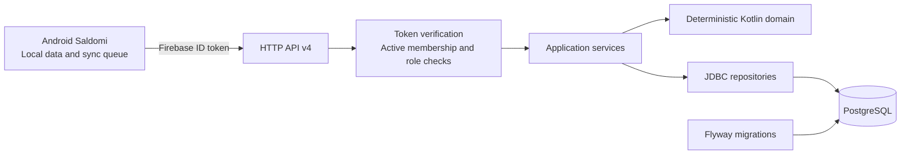

# FinanceConsultante

**The Kotlin / Spring Boot backend for Saldomi, an Android app for personal and family budgeting.**

Saldomi helps users track income and expenses, plan upcoming payments, and manage a shared household budget. The Android client works offline and connects to cloud synchronization explicitly. This repository contains the server application; the Android client is maintained separately.

FinanceConsultante provides a Firebase-authenticated HTTP API, stores financial history in PostgreSQL, and calculates balances, daily spending limits, and forecasts with deterministic Kotlin code.

## Key Features

- **Income and expense tracking:** transaction history, categories, corrections, refunds, and an audit trail.
- **Offline synchronization:** import an existing local budget, preserve UUIDs, and synchronize operations, categories, and plans through API v4. Persistent request receipts make retries idempotent.
- **Personal and family budgets:** multiple budgets per account, owner/member roles, single-use invitation codes, member management, and access revocation.
- **Payment planning:** one-time, weekly, and monthly expense rules; income rules also support biweekly schedules. Confirmed links connect planned payments to actual transactions.
- **Budget management:** create, rename, and delete budgets; choose KZT, RUB, USD, or EUR as the budget currency. Changing the currency preserves numeric amounts without conversion.
- **Category customization:** category names, icon codes, and per-member usage event synchronization. The Android client calculates frequent and recent category lists.
- **Account lifecycle:** Firebase sign-in with Google or verified email/password, server-side profiles, and profile deletion.
- **Financial calculation services:** savings allocations, daily budget estimates, analytics, forecasts, recurring expense detection, and purchase affordability calculations. Availability in the Android UI depends on the client integration.

## Technology Stack

| Area | Technology |
| --- | --- |
| Language and runtime | Kotlin 2.3.21, Java 17 |
| Application framework | Spring Boot 4.1.1, Spring MVC, Spring Scheduling |
| Build | Gradle Wrapper 9.5.1, Kotlin DSL |
| Persistence | PostgreSQL 17.11, Spring JDBC / `JdbcClient`, HikariCP |
| Database migrations | Flyway SQL migrations |
| Authentication | Firebase Authentication, Firebase Admin SDK 9.11.0 |
| Observability | Spring Boot Actuator, Micrometer, Prometheus |
| Testing | JUnit Jupiter, Kotlin Test, AssertJ, PostgreSQL Testcontainers, WireMock |
| Code quality | ktlint 1.8.0, Detekt 2.0.0-alpha.3, JaCoCo 0.8.15 |
| Delivery | Docker, Docker Compose, GitHub Actions; Railway deployment runbook |
| Optional integrations | Currencylayer exchange-rate adapter; OpenAI Java SDK 4.61.0 for standalone recognition evaluation |

Dependency declarations live in [build.gradle.kts](build.gradle.kts). Spring Boot dependency management supplies the versions of managed libraries. Detekt uses a prerelease compatible with the project's Kotlin compiler and is a development tool only.

## Architecture

FinanceConsultante is a **modular monolith**: one Gradle module and one deployable Spring Boot application, organized by business capability.



Business modules use three layers where needed:

- `domain`: financial models and calculations, independent of Spring, SQL, and external APIs.
- `application`: use cases, transaction coordination, and repository/provider interfaces.
- `infrastructure`: HTTP controllers, JDBC repositories, external adapters, and Spring configuration.

The base package is `com.firkatdavletov.financeconsultante`.

| Package | Responsibility |
| --- | --- |
| `auth`, `access` | Firebase identity, profile lifecycle, family membership, and authorization |
| `mobileapi` | Mobile HTTP contracts, budget management, and synchronization |
| `ledger` | Entries, categories, balances, corrections, and audit history |
| `budget`, `analytics` | Daily budgets, reports, and forecasts |
| `recurring` | Expense and income rules, dated occurrences, and recurring expense analysis |
| `goals`, `advice` | Savings allocations and purchase affordability calculations |
| `exchange` | Exchange-rate provider, persistent jobs, and retries |
| `ai` | Standalone recognition provider and validation contracts |
| `operations`, `shared` | Metrics, accounting time, money types, and shared configuration |

### Financial and Access Guarantees

- Monetary calculations use `BigDecimal`; monetary API fields use decimal strings.
- Expected income does not become available cash until it is actually recorded. Reserving savings does not create an expense.
- Firebase UID verification and active budget membership checks precede access to financial data. The server determines permissions.
- Transactions, database constraints, and request receipts prevent repeated delivery of a `requestId` from changing the budget twice.
- Financial history and stable identifiers are preserved across synchronization. Schema changes use versioned Flyway migrations.
- AI output is an untrusted proposal that must pass validation; it does not calculate balances or write directly to the ledger.

See [ARCHITECTURE.md](ARCHITECTURE.md) for detailed invariants and engineering conventions. Historical Telegram sections in that document describe the former application.

## Build and Run

### Prerequisites

- **JDK 17**, available through `JAVA_HOME` or your shell.
- **Docker with Docker Compose v2+** for the local database and standard integration tests.
- Network access on the first build to download Gradle and dependencies.

Use the included Gradle Wrapper; a separate Gradle installation is not required. On Windows, use `gradlew.bat` and configure environment variables in your shell or IDE. The commands below use bash/zsh.

### Local Setup

Run these commands from the repository root:

```bash
java -version
./gradlew --version
cp .env.example .env
```

Edit `.env` and replace the example `POSTGRES_PASSWORD` before continuing. Spring Boot does **not** load `.env` automatically; export your local configuration:

```bash
set -a
. ./.env
set +a

docker compose up -d --wait postgres
./gradlew bootRun
```

The default `local` profile starts the server on port `8080` (override with `PORT`). Check database-aware readiness at `http://localhost:8080/actuator/health/readiness`.

PostgreSQL binds to `127.0.0.1:5432` by default. Set `POSTGRES_PORT` if that port is occupied. Data persists in the `postgres-data` volume; `docker compose stop postgres` stops the database while preserving it.

Flyway applies migrations from `src/main/resources/db/migration` at startup. The initial database contains no personal financial data. Once Firebase is configured, create or import a budget through API v4.

### Build an Executable JAR

```bash
./gradlew bootJar
java -jar build/libs/FinanceConsultante-0.0.1-SNAPSHOT.jar --spring.profiles.active=local
```

The JAR uses the database environment configured above. `bootJar` packages the application but does not run the full verification suite.

### Enable the Mobile API

Mobile endpoints and Firebase authentication are disabled by default. To enable them, set the following before starting the application:

```bash
export MOBILE_API_ENABLED=true
export FIREBASE_AUTH_ENABLED=true
export FIREBASE_PROJECT_ID='<your-firebase-project-id>'
export GOOGLE_APPLICATION_CREDENTIALS='/absolute/path/to/service-account.json'
./gradlew bootRun
```

Keep the service-account file outside the repository and the Android app. The backend verifies Firebase ID tokens and does not issue its own JWT. See the [Firebase setup guide](docs/firebase-authentication.md) and [email/password contract](docs/firebase-email-password.md).

### Configuration Profiles

| Profile | Purpose |
| --- | --- |
| `local` | Default profile; database settings come from `POSTGRES_*` or explicit `DATABASE_*` variables |
| `test` | Isolated test database; external adapters are disabled unless a test explicitly configures a stub |
| `prod` | Requires `DATABASE_URL` in JDBC format, `DATABASE_USERNAME`, and `DATABASE_PASSWORD` |

[.env.example](.env.example) lists configuration variables. Keep credentials in the process environment or a secret store. Firebase, OpenAI, and Currencylayer credentials are not required to build the JAR or run the standard tests.

The optional exchange-rate adapter is separate from budget currency selection. It obtains live RUB/KZT cross rates from Currencylayer; it does not provide general conversion between all four budget currencies. Accounting dates use `Asia/Almaty`.

## Testing and Quality Checks

Run the full verification and packaging sequence with Docker running:

```bash
./gradlew --no-daemon clean check bootJar
```

For the first verification of a new Docker environment, add `--no-build-cache` so test results are not restored from the build cache.

| Command | Purpose |
| --- | --- |
| `./gradlew test` | Unit tests and isolated external-provider contract tests |
| `./gradlew integrationTest` | PostgreSQL/Testcontainers tests for migrations, persistence, HTTP flows, transactions, and concurrency |
| `./gradlew ktlintCheck` | Kotlin and Gradle Kotlin DSL formatting checks |
| `./gradlew ktlintFormat` | Apply formatting |
| `./gradlew detekt` | Static analysis |
| `./gradlew jacocoTestReport` | Run both test suites and generate combined coverage reports |
| `./gradlew check` | Unit and integration tests, ktlint, Detekt, and JaCoCo |
| `./gradlew bootJar` | Package the executable Spring Boot JAR |

Gradle forces the `test` profile and disables external Firebase, mobile, and exchange-rate adapters through system properties. Endpoint tests enable the required components with stub authentication. WireMock replaces external HTTP providers; ordinary tests do not call paid APIs.

Integration tests start an isolated PostgreSQL 17.11 container. Missing Docker causes a failure rather than a silent skip or fallback.

<details>
<summary>Explicit local PostgreSQL test mode</summary>

For diagnostics without Docker, prepare a separate PostgreSQL 17 cluster with an empty database named `financeconsultante_test`, role `test_owner`, and synthetic password `synthetic-test-password`. Then run:

```bash
./gradlew check bootJar \
  -PtestPostgresUrl=jdbc:postgresql://127.0.0.1:55432/financeconsultante_test
```

Only this database name on `127.0.0.1` with an explicit port is accepted. Tests migrate and modify this database and its schema, so it must be disposable. This mode checks SQL behavior but does not validate Docker or Testcontainers. CI uses the standard Docker mode.

</details>

Generated reports are available locally after their tasks run:

- Unit tests: `build/reports/tests/test/index.html`
- Integration tests: `build/reports/tests/integrationTest/index.html`
- ktlint: `build/reports/ktlint/`
- Detekt: `build/reports/detekt/detekt.html`
- Coverage: `build/reports/jacoco/test/html/index.html`

The [GitHub Actions workflow](.github/workflows/ci.yml) runs on pushes to `main`, pull requests, and manual dispatch. It verifies Docker, runs `clean check bootJar`, and builds the deployment image. The workflow does not publish or deploy the application.

## Development Status

**Under active development.** The application version is `0.0.1-SNAPSHOT`; the current mobile contract is **Firebase API v4**.

The repository includes the financial core, Firebase authentication, budget creation and import, family invitations and membership, offline synchronization, rule editing, profile deletion, budget currency selection, and category usage synchronization. Automated unit and PostgreSQL integration tests accompany the implementation.

Current boundaries:

- Android Saldomi is the active client. Telegram integration, polling, dialogs, and scheduled message delivery have been removed; historical migrations and identifiers remain for existing budgets.
- Static mobile-token authentication and the former public v1–v3 / unscoped v4 financial endpoints are disabled. Current financial synchronization is scoped to `/api/v4/budgets/{budgetId}`.
- `confirmedPlanLinkingV1`, `incomeRuleEditingV1`, and `categoryUsageV1` are available. `dailyLimitPlanningV1`, including remainder-income confirmation, is not implemented on the server.
- The OpenAI provider, validator, and synthetic evaluation corpus remain available for separately enabled evaluation via `./gradlew openAiModelEvaluation`. Recognition is not part of the active mobile workflow, and live paid evaluation is excluded from `test` and `check`.
- Docker packaging and a Railway deployment runbook are provided. Repository implementation and automated checks do not establish production deployment or Android end-to-end acceptance for every recent feature; feature documents record release requirements and remaining checks.

See [CONTEXT.md](CONTEXT.md) for the detailed implementation record and feature-specific verification notes.

## Documentation

Most detailed engineering documents are currently written in Russian.

| Topic | Reference |
| --- | --- |
| Product scope and implementation history | [Project context](CONTEXT.md) |
| Architecture, financial invariants, and code style | [Architecture](ARCHITECTURE.md) |
| Firebase setup and sign-in | [Authentication](docs/firebase-authentication.md), [email/password](docs/firebase-email-password.md) |
| Budget creation, import, and management | [Firebase budgets](docs/firebase-budgets.md), [management](docs/budget-management.md), [currencies](docs/budget-currencies.md) |
| Family collaboration | [Invitations](docs/firebase-budget-invitations.md), [membership](docs/firebase-family-budgets.md) |
| Planning and transaction links | [Rule editing](docs/full-rule-editing.md), [one-time rules](docs/one-time-expense-rules.md), [confirmed links](docs/mobile-operation-plan-links.md) |
| Categories and account lifecycle | [Category icons](docs/category-icons.md), [profile deletion](docs/firebase-profile-deletion.md) |
| API migration and installation access | [Static-token retirement](docs/firebase-static-token-retirement.md), [installation access](docs/internal-device-access.md) |
| Deployment, backups, and recovery | [Railway runbook](docs/RAILWAY_DEPLOYMENT.md) |
| Contributor agent instructions | [AGENTS.md](AGENTS.md) |
